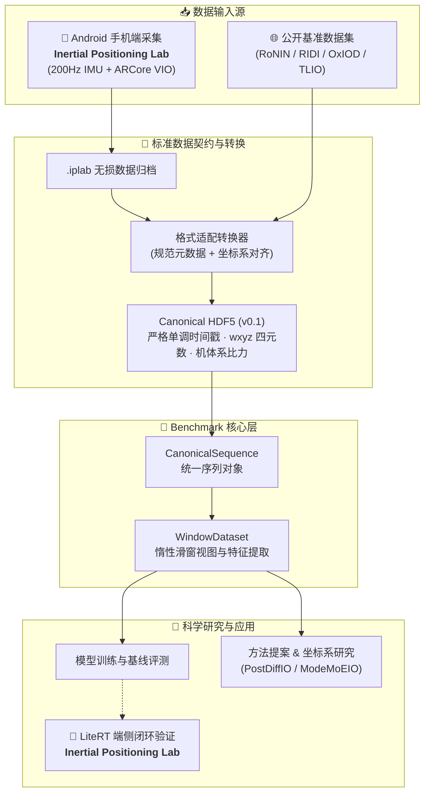

<div align="center">

# 🧭 Inertial Positioning Benchmark

### 面向惯性定位研究的统一数据接口、采集工具与可复现实验平台

[](https://github.com/BUG423/inertial-positioning-benchmark/actions/workflows/ci.yml)

[](https://github.com/BUG423/inertial-lab)
[](LICENSE)


**🇨🇳 中文** · [🇬🇧 English](README_EN.md)

[快速开始](#-快速开始) · [研究内容](#-研究内容) · [路线图](#-路线图) · [贡献与许可](#-贡献与许可)

</div>

---

## 🌟 项目简介

不同惯性里程计项目往往采用不同的数据格式、坐标系、窗口定义和评测协议，导致方法难以公平比较、实验难以完整复现。本仓库将以下内容统一组织在一套边界清晰的研究基础设施中：

- 📦 **标准数据接口**：统一时间戳、坐标系、单位、HDF5 存储与惰性滑窗数据集；
- 📱 **配套数据采集**：与独立移动端实验工具 [Inertial Positioning Lab](https://github.com/BUG423/inertial-lab) 深度协同，支持 Android IMU 与 ARCore VIO 参考轨迹；
- 🧪 **研究内容体系**：保存前沿方法提案、运动坐标系实证研究和可追溯图表；
- 🧠 **科研工作流**：整合面向惯性里程计的专门研究技能工具；
- 📚 **环境复现文档**：归档 FAST-LIVO 在 Ubuntu 20.04 + ROS Noetic 下的完整编译与复现记录；
- ✅ **自动化检查**：全量保障 Python 核心接口、数据契约及文档一致性。

### 视觉数据流与工程协同



> [!IMPORTANT]
> `research/methods/` 中的 PostDiffIO 与 ModeMoEIO 当前属于**方法提案**，不代表已经获得可复现的 benchmark 成绩。只有代码、配置、数据划分和结果均可审计的方法，才会进入正式基线。

## 🧩 当前组件

| 组件 | 状态 | 仓库 / 说明 |
| :--- | :--- | :--- |
| **Benchmark Core** | ✅ 可用 | 本仓库内 `CanonicalSequence`、HDF5 I/O、窗口数据集与核心测试 |
| **Inertial Positioning Lab** | 📱 独立工程 | [BUG423/inertial-lab](https://github.com/BUG423/inertial-lab) 专注于 Android 200Hz 采集、ARCore VIO 实时画布、`.iplab` 归档与 LiteRT 端侧推理 |
| **Pedestrian Coordinate Frames** | 📊 研究记录 | [Global frame 与 body frame](research/studies/pedestrian-coordinate-frames/) 的行人惯导表征实验分析 |
| **PostDiffIO** | 💡 方法提案 | [条件扩散后验细化](research/methods/postdiffio/)与不确定性建模提案 |
| **ModeMoEIO** | 💡 方法提案 | [运动模式感知混合专家路由](research/methods/moe-io/)提案 |
| **PaperFlow IO** | 🛠️ 研究工具 | [PaperFlow IO](tools/paperflow-io/) 惯导专用选题、文献复核与实验规划工作流 |
| **FAST-LIVO Setup** | 📚 环境文档 | [ROS Noetic 环境文档](docs/setup/fast-livo.md) 下的 FAST-LIVO 历史复现指南 |
| **Public Baselines & Leaderboard** | 🚧 规划中 | 自动化公开数据集适配器、固定划分基线、统一评测指标与排行榜 |

## 🚀 快速开始

### 1. 获取并安装

```bash
git clone https://github.com/BUG423/inertial-positioning-benchmark.git
cd inertial-positioning-benchmark
python -m pip install -e ".[test]"
```

项目要求 Python 3.9 或更高版本。

### 2. 运行自动化测试

```bash
pytest -q
```

该命令执行 Python 核心数据接口、Android 数据规范契约以及全仓相对文档链接的自动化校验。

### 3. 读取统一规范数据

```python
from inertial_benchmark import CanonicalSequence, WindowDataset

# 加载标准化 HDF5 序列
sequence = CanonicalSequence.from_hdf5("sequence.h5")

# 构造模型滑窗数据集 (输入形状: 6 x window_size)
dataset = WindowDataset(
    sequence,
    window_size=200,
    stride=10,
    target="velocity",
)
sample = dataset[0]
print("Feature shape:", sample.features.shape)  # (6, 200)
print("Target velocity:", sample.target)         # [vx, vy, vz]
```

核心数据层不依赖任何特定深度学习框架，可直接供 PyTorch、JAX 或 TensorFlow 调用。

### 4. 采集与转换 Android 数据

手机端数据采集与真机评测已解耦为独立工程 [Inertial Positioning Lab](https://github.com/BUG423/inertial-lab)。

使用流程：
1. 从 [inertial-lab Releases](https://github.com/BUG423/inertial-lab) 下载并安装 APK；
2. 在手机端完成 200 Hz IMU 与 ARCore VIO 轨迹采集，导出 `.iplab` 归档；
3. 使用 `inertial-lab` 配套的转换工具导出为符合本基准契约的规范 HDF5：

```bash
python tools/convert_dataset.py recording.iplab --output datasets/android/
```

转换后的序列完全遵循本仓库的 `CanonicalSequence` 规范，可直接投入训练与评测。

## 🔬 研究内容

- 💡 [PostDiffIO](research/methods/postdiffio/)：条件扩散速度残差细化与不确定性建模提案；
- 💡 [ModeMoEIO](research/methods/moe-io/)：运动模式感知混合专家提案；
- 📊 [Pedestrian Coordinate Frames](research/studies/pedestrian-coordinate-frames/)：global-frame 与 body-frame 表征研究；
- 🧠 [PaperFlow IO](tools/paperflow-io/)：仅包含 IO 选题、文献复核、可行性评审与实验设计技能；
- 📚 [FAST-LIVO 环境配置](docs/setup/fast-livo.md)：Ubuntu 20.04 与 ROS Noetic 环境下的历史复现说明。

## 🛣️ 路线图

- [x] 定义统一序列结构、坐标系与单位约定
- [x] 实现 HDF5 I/O、窗口数据集和核心测试
- [x] 解耦 Android 数据采集工程为独立仓库并制定统一转换契约
- [x] 整合研究方法提案、坐标系实证研究和 PaperFlow IO
- [x] 归档并整合 FAST-LIVO 的 ROS 1 环境复现指南
- [ ] 接入首个可自动转换的公开数据集适配器
- [ ] 集成至少一个端到端可复现基线
- [ ] 固化数据划分与统一评测指标
- [ ] 发布版本化 benchmark 结果和排行榜

## 🤝 贡献与许可

本仓库只维护 `main` 分支。提交内容前请阅读[贡献规范](CONTRIBUTING.md)，并为数据集、模型和第三方资源记录来源、许可证与再分发限制。

本项目采用 **Creative Commons Attribution-NonCommercial-NoDerivatives 4.0 International (CC BY-NC-ND 4.0)** 许可协议。
仅允许出于个人学习、学术交流与非商业性研究所需的阅读、本地运行与学习测试；未经原作者明确书面授权，严格禁止任何形式的商业用途与营利行为，禁止对外分发修改后的演绎产物。详见 [LICENSE](LICENSE)。

---

<div align="center">

如果这个项目对你的研究有帮助，欢迎 ⭐ Star 并关注后续 benchmark 更新。

</div>
