# 🧭 other-inertial-benchmark

[](https://github.com/BUG423/other-inertial-benchmark/actions/workflows/ci.yml)
[](https://www.python.org/)
[](https://pytorch.org/)
[](https://github.com/BUG423/app-inertial-lab)
[](LICENSE)

[**🇨🇳 中文**](README.md) · **🇬🇧 English**

> **other-inertial-benchmark** provides unified data contracts, algorithm interfaces, comparable evaluation and auditable experiments for inertial positioning research.

---

## 🌟 Introduction

The deliverable is an extensible benchmark: dataset-specific converters produce a common storage contract; algorithms retain required windows, outputs and losses through unified interfaces; results use explicit splits, input permissions and evaluation protocols, with configuration and provenance preserved.

**Use `dev/v1` throughout**: IPB v1 data, the `NIO` API, `ipb` CLI and existing model/converter interfaces define new integrations. Implementation does not establish reproduced paper accuracy. Official sources, independent implementations, paper assumptions and adaptations are recorded in [algorithm cards](docs/ALGORITHMS.md).

## ✨ Capabilities and Components

| Component | Current capability | Entry and scope |
| :--- | :--- | :--- |
| **Data layer** | IPB v1 HDF5, 200 Hz, units/frames, provenance, masks, grouped splits and checks | [Design](docs/DESIGN.md) · [Dataset catalog](docs/DATASETS.md) |
| **Core converters** | Eight existing converters: RoNIN, RIDI, OxIOD, TLIO, IDOL, RNIN, IMUNet and PedLocData | [Cards](docs/datasets/) · [Code](src/inertial_benchmark/data/converters/); acquisition and acceptance are recorded separately |
| **Algorithms** | 29 registered architectures, 31 model configurations and 21 packages; RoNIN, TLIO, RNIN, IMUNet, EqNIO, AirIO, DIVE and classical baselines | [Specifications/fidelity](docs/ALGORITHMS.md) · [Configurations](src/inertial_benchmark/cfg/models/) |
| **Training/prediction** | `NIO` / `ipb`, shared Trainer/Validator/Predictor; window/frame/multi-step/sequence interfaces | [Commands](docs/CLI.md); retain required layouts and losses; an export API is still pending |
| **Evaluation/reports** | ATE, separate aligned diagnostics, time/distance RTE, endpoint drift, length ratios, velocity/direction, efficiency; CSV/Markdown/LaTeX, statistics and plots | [Definitions](docs/METRICS.md); scaling, oracle and aligned diagnostics have distinct meanings |
| **New data intake** | EuRoC 11 recordings and Blackbird 20 published segments converted to native v1 and passed full/hash checks; Pegasus/ADVIO audited and rejected; a TartanIMU 2025 source card added | [Current status](docs/DEV_V1_INTEGRATION.md) · [Cards](docs/datasets/); Blackbird uses route groups and a test-only audit list |
| **Independent APP** | Android capture and on-device evaluation | [BUG423/app-inertial-lab](https://github.com/BUG423/app-inertial-lab) · [Exchange contract](docs/TOOLS.md); ARCore is a VIO reference |
| **Research/provenance** | Trajectory shrinkage, frame studies, proposals and IO research tools | [Research](research/README.md) · [Tools](tools/README.md); proposals and validated experiments are distinct |

### Data and Experiment Flow

```mermaid
flowchart LR
    Raw["Public datasets / independent APP"] --> Audit["Provenance, units, clocks and frame audit"]
    Audit --> Convert["Dataset-specific converter"]
    Convert --> Data["IPB v1 HDF5, masks, splits and fingerprints"]
    Data --> View["Task views: windows, targets and input permissions"]
    View --> Train["NIO / ipb: train, validate and predict"]
    Train --> Eval["Fixed-protocol metrics, trajectories and efficiency"]
    Eval --> Report["Tables, statistics, plots and experiment records"]
    Report --> Study["Shrinkage and generalization studies"]
```



## 🛠️ Technology and Entry Points

| Technology / location | Purpose |
| :--- | :--- |
| Python ≥ 3.9, NumPy, SciPy, h5py, PyYAML | Storage, resampling, geometry and configuration |
| PyTorch ≥ 2.0, pandas, matplotlib | Training, reporting and scientific plots |
| [src/inertial_benchmark/](src/inertial_benchmark/) | `cfg`, `data`, `models`, `nn`, `engine`, `metrics` and `utils` |
| [tests/](tests/) · [.github/workflows/ci.yml](.github/workflows/ci.yml) | Analytical, model/data contract, engine and documentation checks |
| [docs/](docs/README.md) · [research/](research/README.md) | Specifications, source cards, status and research evidence |

See [repository layout](docs/REPOSITORY_LAYOUT.md) and [Ops v1](tools/ops_v1/README.md) for isolated server deployment and resource profiles.

## 🚀 Quick Start

### 1. Install and inspect registered components

```bash
git clone --branch dev/v1 https://github.com/BUG423/other-inertial-benchmark.git
cd other-inertial-benchmark
python -m venv .venv
. .venv/bin/activate
python -m pip install -e ".[train,test]"
ipb info
ipb cfg model=ronin_resnet18 recipe=unified
```

Use `pip install -e .` for data only. IDOL Feather sources require `pip install -e ".[idol]"`. Select the appropriate PyTorch CPU/CUDA build.

### 2. Convert and check

Acquire files following the [RIDI card](docs/datasets/ridi.md), then set `source` to their actual location:

```bash
export IPB_DATASETS="$PWD/datasets"
ipb convert dataset=ridi source=raw/ridi workers=1
ipb check data=ridi full=true hash=true
```

Outputs include `sequences/*.h5`, `splits/*.txt`, `dataset.json` and `conversion_report.json`. Configuration lives in [cfg/datasets/](src/inertial_benchmark/cfg/datasets/). Retain official seen/unseen labels without imposing them on every dataset.

### 3. CPU workflow example

These strides and training budgets are for engineering checks:

```bash
ipb train model=ronin_resnet18 data=ridi device=cpu epochs=1 batch=2 workers=0 cache=false stride=200 eval_stride=200 project=runs/cpu-smoke name=ridi-ronin
ipb val model=runs/cpu-smoke/train/ridi-ronin/weights/best.pt data=ridi split=val device=cpu workers=0 cache=false eval_stride=200 project=runs/cpu-smoke
ipb predict model=runs/cpu-smoke/train/ridi-ronin/weights/best.pt source=datasets/ridi/sequences device=cpu workers=0 eval_stride=200
```

Equivalent API:

```python
from inertial_benchmark import NIO

model = NIO("ronin_resnet18")
model.train(data="ridi", device="cpu", epochs=1, batch=2, workers=0, cache=False)
```

Full GPU experiments require frozen splits, documented recipes and sufficient training. Record unified/official recipe differences. A one-epoch CPU check does not establish rankings or paper accuracy.

### 4. Matrix and reports

```bash
ipb benchmark cfg=main dry_run=true
ipb report runs=runs/cpu-smoke out=reports/cpu-smoke
pytest -q -m "not slow"
```

See the example [main.yaml](src/inertial_benchmark/cfg/benchmarks/main.yaml). Select accepted data/models and check resource budgets before execution. Complete commands are in [CLI.md](docs/CLI.md).

APP source, APKs, `.iplab` conversion and builds belong to [app-inertial-lab](https://github.com/BUG423/app-inertial-lab). Legacy readability and v1 training admission are separate; see [exchange limitations](docs/TOOLS.md).

## 🔬 Research and Validation Status

On the current AutoDL server, three RIDI and three RoNIN recordings were converted to native v1. Representative short CPU NIO runs completed training, validation, prediction and checkpoint reload consistency checks (one epoch / two updates each). The 31 new native v1 files passed data acceptance; full-suite counts follow this round's records before full GPU training. The **705 tests**, scores and AMP/dropout observations in the 2026-09-24 handoff are historical results from another environment, not current-server verification. Refer to [project status](docs/DEV_V1_INTEGRATION.md) and acceptance records.

Shrinkage should be tested through target/integration oracles, time/length resolution, speed/direction, train/eval mode differences, precision and generalization. Existing length decomposition and mode guards provide a starting point; conclusions require sufficiently trained algorithms and controlled experiments.

| Research entry | Evidence status |
| :--- | :--- |
| [Pedestrian Coordinate Frames](research/studies/pedestrian-coordinate-frames/) | Historical frame studies and assets |
| [PostDiffIO](research/methods/postdiffio/) · [ModeMoEIO](research/methods/moe-io/) | Proposals without reproducible results from this benchmark round |
| [PaperFlow IO](tools/paperflow-io/) | IO ideation, literature review and experiment planning |
| [FAST-LIVO setup](docs/setup/fast-livo.md) | Historical ROS Noetic reproduction notes |

## 🛣️ Roadmap

| Stage | Deliverable and acceptance |
| :--- | :--- |
| **Existing foundation** | v1 sequences/views, eight core converters, algorithm interfaces, train/validate/predict, metrics and reports |
| **Current CPU stage** | EuRoC/Blackbird conversion and checks accepted; finish full-suite and environment acceptance on the current server |
| **Evaluation increments** | Permission tracks, NA/coverage, consistent 3D plots, paging/facets beyond eight models, six panels and static HTML |
| **GPU stage** | One seed to validate recipes/full training, then expand the matrix; at most three seeds for final key experiments |
| **Research delivery** | Auditable benchmark, shrinkage mechanisms and controlled experiments, reproducible release; ICRA / IEEE RA-L target |

See [project status](docs/DEV_V1_INTEGRATION.md) for outstanding work.

## 📄 License and Intellectual Property

This project uses **[CC BY-NC-ND 4.0](LICENSE)** (Attribution–NonCommercial–NoDerivatives). Follow the repository license for use, credit and sharing. Commercial use and distribution of modified versions require permission.

Datasets, third-party code, independent tools and weights retain their own terms and provenance; the repository license does not replace third-party authorization. Cite original papers and record adaptations. Read [CONTRIBUTING.md](CONTRIBUTING.md) before submitting changes.

---

<div align="center">

If this project helps your research, please ⭐ Star and follow future reproducible benchmark releases.

</div>
