# 🧭 other-inertial-benchmark

[](https://github.com/BUG423/other-inertial-benchmark/actions/workflows/ci.yml)
[](https://www.python.org/)
[](https://pytorch.org/)
[](https://github.com/BUG423/app-inertial-lab)
[](LICENSE)

[**🇨🇳 中文**](README.md) · **🇬🇧 English**

> **other-inertial-benchmark** provides unified data contracts, algorithm interfaces, comparable evaluation and auditable experiments for inertial positioning research.

---

## 🌟 Introduction

The deliverable is an extensible benchmark: dataset-specific converters produce a common storage contract; algorithms retain required windows, outputs and losses through unified interfaces; results use explicit splits, input permissions and evaluation protocols, with configuration and provenance preserved.

**Use `dev/v1` throughout**: IPB v1 data, the `NIO` API, `ipb` CLI and existing model/converter interfaces define new integrations. Implementation does not establish reproduced paper accuracy. Official sources, independent implementations, paper assumptions and adaptations are recorded in [algorithm cards](docs/ALGORITHMS.md).

## ✨ Capabilities and Components

| Component | Current capability | Entry and scope |
| :--- | :--- | :--- |
| **Data layer** | IPB v1 HDF5, 200 Hz, units/frames, provenance, masks, grouped splits and checks | [Design](docs/DESIGN.md) · [Dataset catalog](docs/DATASETS.md) |
| **Data intake** | Acquired versions/subsets from 13 independent sources accepted as native XYZ: 1,376 sequences, 114.30638333 hours; 9 with train/val and 4 test-only | [Cards](docs/datasets/) · [Converters](src/inertial_benchmark/data/converters/); provenance, rejections and splits in [current status](docs/DEV_V1_INTEGRATION.md) |
| **Algorithms** | 31 active architectures and 53 profiles; 21 paper methods (19 published, 2 preprints) plus 2 classical definitions | [Specifications/fidelity](docs/ALGORITHMS.md) · [Profiles](src/inertial_benchmark/cfg/models/); backbone and dimension variants do not increase paper count |
| **Training/prediction** | `NIO` / `ipb`, shared Trainer/Validator/Predictor; window/frame/multi-step/sequence interfaces | [Commands](docs/CLI.md); retain required layouts and losses; an export API is still pending |
| **Evaluation/reports** | 56 default XYZ trajectory/velocity output keys plus XY from the same prediction; ATE/RTE/RPE, error quantiles, drift, length/direction, coverage and efficiency; native-task Gaussian uncertainty | [Definitions](docs/METRICS.md); 25 native-task uncertainty nodes passed server tests; absent predicted attitude/covariance is unavailable |
| **Cross-domain data** | EuRoC, Blackbird, GrandTour, SubT-MRS and UZH-FPV accepted under their actual reference contracts; the latter three are representative subsets | [Current status](docs/DEV_V1_INTEGRATION.md) · [Cards](docs/datasets/); test-only sources use preregistered checkpoint transfer; human-to-robot results remain a separate diagnostic track |
| **Independent APP** | Android capture and on-device evaluation | [BUG423/app-inertial-lab](https://github.com/BUG423/app-inertial-lab) · [Exchange contract](docs/TOOLS.md); ARCore is a VIO reference |
| **Research/provenance** | Trajectory shrinkage, frame studies, proposals and IO research tools | [Research](research/README.md) · [Tools](tools/README.md); proposals and validated experiments are distinct |

### Data and Experiment Flow

```mermaid
flowchart LR
    Raw["Public datasets / independent APP"] --> Audit["Provenance, units, clocks and frame audit"]
    Audit --> Convert["Dataset-specific converter"]
    Convert --> Data["IPB v1 HDF5, masks, splits and fingerprints"]
    Data --> View["Task views: windows, targets and input permissions"]
    View --> Train["NIO / ipb: train, validate and predict"]
    Train --> Eval["Fixed-protocol metrics, trajectories and efficiency"]
    Eval --> Report["Tables, statistics, plots and experiment records"]
    Report --> Study["Shrinkage and generalization studies"]
```



## 🛠️ Technology and Entry Points

| Technology / location | Purpose |
| :--- | :--- |
| Python ≥ 3.9, NumPy, SciPy, h5py, PyYAML | Storage, resampling, geometry and configuration |
| PyTorch ≥ 2.0, pandas, matplotlib | Training, reporting and scientific plots |
| [src/inertial_benchmark/](src/inertial_benchmark/) | `cfg`, `data`, `models`, `nn`, `engine`, `metrics` and `utils` |
| [tests/](tests/) · [.github/workflows/ci.yml](.github/workflows/ci.yml) | Analytical, model/data contract, engine and documentation checks |
| [docs/](docs/README.md) · [research/](research/README.md) | Specifications, source cards, status and research evidence |

See [repository layout](docs/REPOSITORY_LAYOUT.md) and [Ops v1](tools/ops_v1/README.md) for isolated server deployment and resource profiles.

## 🚀 Quick Start

### 1. Install and inspect registered components

```bash
git clone --branch dev/v1 https://github.com/BUG423/other-inertial-benchmark.git
cd other-inertial-benchmark
python -m venv .venv
. .venv/bin/activate
python -m pip install -e ".[train,test,ridi,grandtour,idol]"
ipb info
ipb cfg model=ronin_resnet18_3d metric_dims=3 recipe=unified
```

The command includes full-benchmark extras: `ridi` supplies scikit-learn, `grandtour` supplies numcodecs and `idol` enables Feather/Arrow reading. Use `pip install -e .` for the base data layer and choose extras following each data card. Select the appropriate PyTorch CPU/CUDA build.

### 2. Convert and check

Acquire files following the [RIDI card](docs/datasets/ridi.md), then set `source` to their actual location:

```bash
export IPB_DATASETS="$PWD/datasets"
ipb convert dataset=ridi source=raw/ridi workers=1
ipb check data=ridi full=true hash=true
```

Outputs include `sequences/*.h5`, `splits/*.txt`, `dataset.json` and `conversion_report.json`. Configuration lives in [cfg/datasets/](src/inertial_benchmark/cfg/datasets/). Retain official seen/unseen labels without imposing them on every dataset.

The AutoDL checkout accepted in this round contains the accepted RIDI/RoNIN/IDOL/RNIN/TLIO/OxIOD/IMUNet versions under `datasets/ipb-v1/full-core/`. From that server checkout root, use:

```bash
export IPB_DATASETS="$PWD/datasets/ipb-v1/full-core"
ipb check data=ridi full=true hash=true
ipb cfg model=ronin_resnet18_3d data=ridi metric_dims=3 recipe=unified
```

### 3. CPU workflow example

CPU acceptance runs on AutoDL. These strides and training budgets are for engineering checks:

```bash
ipb train model=ronin_resnet18_3d data=ridi metric_dims=3 device=cpu epochs=1 batch=2 val_batch=2 workers=0 cache=false stride=200 eval_stride=200 project=runs/cpu-smoke name=ridi-ronin
ipb val model=runs/cpu-smoke/train/ridi-ronin/weights/best.pt data=ridi split=val metric_dims=3 device=cpu val_batch=2 workers=0 cache=false eval_stride=200 project=runs/cpu-smoke
ipb predict model=runs/cpu-smoke/train/ridi-ronin/weights/best.pt source="$IPB_DATASETS/ridi/sequences" metric_dims=3 device=cpu val_batch=2 workers=0 eval_stride=200
```

Equivalent API:

```python
from inertial_benchmark import NIO

model = NIO("ronin_resnet18_3d", metric_dims=3)
model.train(data="ridi", device="cpu", epochs=1, batch=2, val_batch=2, workers=0, cache=False)
```

Native data retain **XYZ in three dimensions**. Profiles with actual XYZ output use `metric_dims=3`, with `xy_` metrics derived from the same predictions; original 2D profiles remain a separate XY reference protocol. Each `3d_adapted` profile records its output-head and required target adaptations without claiming paper accuracy or 2D checkpoint equivalence. Capability checks cover all 31 architectures / 53 profiles. Missing predicted Z is never replaced by zeros or reference values. TLIO currently covers the network, without the paper's EKF.

Reference attitude or initial state as input carries `reference/oracle` permission and is separated from deployable sensor tracks; same-device VIO labels retain their reference classification. AutoDL's 4090D has completed standard GPU engineering lifecycles for all 49 neural profiles and CPU workflows for all 53 profiles. Sufficient-training budgets, common sampling and full-matrix cost are still being validated before freezing.

### 4. Matrix and reports

`cfg=main` is the full-matrix entry after AutoDL deployment acceptance and formal recipe freezing. It requires a generated data registry, seed record, frozen policy and resource admission. A fresh clone must establish these first; the current formal policy is still pending freeze. Use the single-model workflow above to check installation and data interfaces.

```bash
ipb benchmark cfg=main dry_run=true
ipb report runs=runs/cpu-smoke out=reports/cpu-smoke
pytest -q -m "not slow"
```

[main.yaml](src/inertial_benchmark/cfg/benchmarks/main.yaml) above is a CLI example. The formal [full_matrix.py](tools/ops_v1/full_matrix.py) builds coverage from all active profiles, the accepted data registry and the three once-sampled seeds: currently 53 × 13 × 3 = **2,067 cells**. Unsupported capabilities, pending checkpoints and failures remain explicit. Enumeration is not completed training. See [CLI](docs/CLI.md) and [Ops v1](tools/ops_v1/README.md).

APP source, APKs, `.iplab` conversion and builds belong to [app-inertial-lab](https://github.com/BUG423/app-inertial-lab). Legacy readability and v1 training admission are separate; see [exchange limitations](docs/TOOLS.md).

## 🔬 Research and Validation Status

The accepted scope is **13 independent sources, 1,376 native sequences and 114.30638333 hours**: RIDI 94, RoNIN 151, IDOL 130, RNIN 300, TLIO 354, OxIOD 126, IMUNet 113, EuRoC 11, Blackbird 20, GrandTour 1, SubT-MRS 28, UZH-FPV 1 and PedLocData Demo 47. The eight human sources plus EuRoC are trainable, with 827 train sequences; Blackbird, GrandTour, SubT-MRS and UZH-FPV are currently test-only. Acceptance covers acquired versions or representative subsets, not every public release in full. External positioning, VIO, fused estimation and vision-based pose references retain their separate fidelity limits and warnings in [current status](docs/DEV_V1_INTEGRATION.md).

New-server storage snapshot (**2026-10-13 16:52 UTC / 2026-10-14 00:52 Beijing**): all retained archives, extracted raw data, native data, historical copies, engineering fixtures and partials occupy **82.519 GB** after deduplication; the 12 formal native datasets occupy **4.602 GB**, with **174.900 GB** free at that time. Subsequent downloads and outputs change usage. Formal sequence counts exclude pilots, historical copies, the TartanIMU mixed-source repackaging and overlapping auxiliary test views. Existing local source archives are accounted separately from server totals.

**53/53 profiles passed CPU engineering workflows and 49/49 neural profiles passed standard GPU lifecycles**, including actual updates, validation, prediction and checkpoint reload. Classical or CPU-only methods use their actual calibration/regression workflows. Hardware is an RTX 4090D with 24 GiB. Short fixtures and a few updates do not reproduce paper accuracy; **sufficient-training formal benchmark runs have not started**. All 49 unique targeted framework nodes ultimately passed; the 25 native-task uncertainty nodes also have passing server evidence. Sampling/scheduler/NIO performance increments and the formal recipe remain under targeted validation; counts are not added to historical suites.

PedLocData currently includes only the complete, official-MD5-verified Demo: 47 accepted / 0 rejected, grouped 32/9/6 with disjoint 9/2/2 recording groups, full/hash and actual XYZ/XY B2 checks passed. The main file continues its bounded download; historical full-release counts are not this acquired scope.

Every formal cell uses the same once-sampled OS-random seeds: **1735231569, 843628571, 951150512**. Preregistered test-only transfer uses matching-profile/seed EuRoC checkpoints for Blackbird and UZH-FPV, and RIDI checkpoints for GrandTour and SubT-MRS. Human-to-robot evaluation is a cross-domain diagnostic outside the human in-domain training leaderboard. Cells preserve source, fingerprints, scientific input contracts, recipe and checkpoint identity.

Counts distinguish **31 architectures / 53 profiles / 21 paper methods (19 published + 2 preprints) / 2 classical definitions**. Pinned reference source is available from 16 official repositories; CTIN, iMoT and MEIO are `source_partial`. Independent adaptations and paper reimplementations are labeled separately. The repository owner's author exclusion policy keeps excluded Shanshan Zhang methods outside the active queue; see the [exclusion record](docs/models/excluded-methods.json). Source availability, interface acceptance and paper-accuracy reproduction are separate evidence.

Trajectory shrinkage requires target/integration-oracle checks, temporal and length resolution, speed magnitude/direction, train/inference modes, precision and generalization tests. Shared diagnostics are prepared; conclusions require full multi-method experiments.

| Research entry | Evidence status |
| :--- | :--- |
| [Pedestrian Coordinate Frames](research/studies/pedestrian-coordinate-frames/) | Historical frame studies and assets |
| [PostDiffIO](research/methods/postdiffio/) · [ModeMoEIO](research/methods/moe-io/) | Proposals without reproducible results from this benchmark round |
| [PaperFlow IO](tools/paperflow-io/) | IO ideation, literature review and experiment planning |
| [FAST-LIVO setup](docs/setup/fast-livo.md) | Historical ROS Noetic reproduction notes |

## 🛣️ Roadmap

| Stage | Deliverable and acceptance |
| :--- | :--- |
| **Data admission** | 13 independent sources accepted with native XYZ, integrity and scientific contract checks; extend actual sources and record missing reference/frame contracts |
| **All-algorithm preparation** | 31 architectures / 53 profiles passed CPU engineering checks; 49 neural profiles passed GPU lifecycles; retain native targets, layouts and losses |
| **Formal protocol freeze** | Validate all-data task views, common sampling, fair budgets, capacity and the full 2,067-cell cost; then freeze the recipe and execute |
| **Evaluation/research** | Same-prediction XYZ/XY, shrinkage decomposition, coverage/NA, reference permissions and domain tracks; produce main tables and controlled ablations after sufficient training |
| **Research delivery** | Auditable benchmark, reproducible release and shrinkage-mechanism evidence; target ICRA / IEEE RA-L |

See [project status](docs/DEV_V1_INTEGRATION.md) for outstanding work.

## 📄 License and Intellectual Property

This project uses **[CC BY-NC-ND 4.0](LICENSE)** (Attribution–NonCommercial–NoDerivatives). Follow the repository license for use, credit and sharing. Commercial use and distribution of modified versions require permission.

Datasets, third-party code, independent tools and weights retain their own terms and provenance; the repository license does not replace third-party authorization. Cite original papers and record adaptations. Read [CONTRIBUTING.md](CONTRIBUTING.md) before submitting changes.

---

<div align="center">

If this project helps your research, please ⭐ Star and follow future reproducible benchmark releases.

</div>
