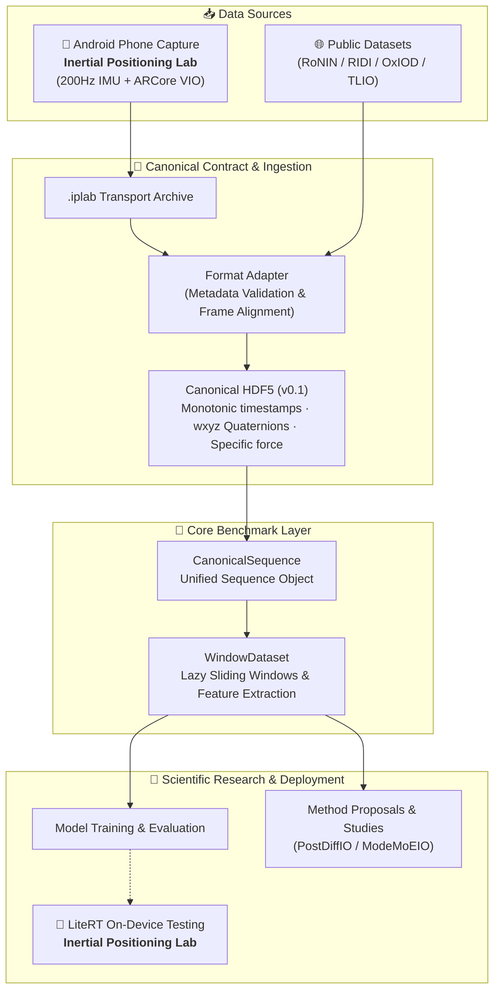

<div align="center">

# 🧭 Inertial Positioning Benchmark

### Unified data interfaces, capture tools, and reproducible evaluation infrastructure for inertial positioning research

[](https://github.com/BUG423/inertial-positioning-benchmark/actions/workflows/ci.yml)

[](https://github.com/BUG423/inertial-lab)
[](LICENSE)


[🇨🇳 中文](README.md) · **🇬🇧 English**

[Quick Start](#-quick-start) · [Research](#-research) · [Roadmap](#-roadmap) · [Contributing and License](#-contributing-and-license)

</div>

---

## 🌟 Overview

Inertial-odometry projects often use incompatible data formats, coordinate frames, window definitions, and evaluation protocols. This repository brings the following components into one clearly bounded research platform:

- 📦 **Canonical data interfaces** for timestamps, coordinate frames, units, HDF5 storage, and windowing;
- 📱 **Ecosystem tooling** integrated with the standalone companion app [Inertial Positioning Lab](https://github.com/BUG423/inertial-lab) for phone IMU and ARCore VIO capture;
- 🧪 **Research material** including method proposals, empirical studies, and figures;
- 🧠 **Research workflows** containing only the inertial-odometry skills retained from PaperFlow;
- 📚 **Reproduction guides** preserving the FAST-LIVO dependency, build, and test workflow for Ubuntu 20.04 + ROS Noetic;
- ✅ **Automated checks** for Python data interfaces, contract validation, and documentation integrity.

### Data Flow and Architecture



> [!IMPORTANT]
> PostDiffIO and ModeMoEIO under `research/methods/` are **method proposals**, not reproducible benchmark results. A method enters the official baselines only when its code, configuration, data splits, and results are auditable.

## 🧩 Components

| Component | Status | Description / Repository |
| :--- | :--- | :--- |
| **Benchmark Core** | ✅ Available | In-tree `CanonicalSequence`, HDF5 I/O, window datasets, and tests |
| **Inertial Positioning Lab** | 📱 Independent | [BUG423/inertial-lab](https://github.com/BUG423/inertial-lab) dedicated to Android 200Hz capture, ARCore VIO canvas, `.iplab` archives, and LiteRT inference |
| **Pedestrian Coordinate Frames** | 📊 Study | [Global-frame versus body-frame](research/studies/pedestrian-coordinate-frames/) empirical representation analysis |
| **PostDiffIO** | 💡 Proposal | [Conditional-diffusion posterior refinement](research/methods/postdiffio/) and uncertainty modeling proposal |
| **ModeMoEIO** | 💡 Proposal | [Motion-aware mixture-of-experts](research/methods/moe-io/) routing proposal |
| **PaperFlow IO** | 🛠️ Research tool | [PaperFlow IO](tools/paperflow-io/) IO-specific ideation, literature validation, and experiment-design skills |
| **FAST-LIVO Setup** | 📚 Environment guide | [Historical FAST-LIVO reproduction notes](docs/setup/fast-livo.md) for Ubuntu 20.04 and ROS Noetic |
| **Public Baselines & Leaderboard** | 🚧 Planned | Dataset adapters, fixed splits, common metrics, and public leaderboard |

## 🚀 Quick Start

### 1. Clone and Install

```bash
git clone https://github.com/BUG423/inertial-positioning-benchmark.git
cd inertial-positioning-benchmark
python -m pip install -e ".[test]"
```

Python 3.9 or later is required.

### 2. Run Automated Checks

```bash
pytest -q
```

This verifies the Python interfaces, canonical data contract compliance, and repository relative documentation links.

### 3. Load Canonical Data

```python
from inertial_benchmark import CanonicalSequence, WindowDataset

# Load canonical sequence from HDF5
sequence = CanonicalSequence.from_hdf5("sequence.h5")

# Create sliding window dataset (features shape: 6 x window_size)
dataset = WindowDataset(
    sequence,
    window_size=200,
    stride=10,
    target="velocity",
)
sample = dataset[0]
print("Feature shape:", sample.features.shape)  # (6, 200)
print("Target velocity:", sample.target)         # [vx, vy, vz]
```

The core data layer is framework-agnostic and ready for PyTorch, JAX, or TensorFlow integration.

### 4. Collecting and Ingesting Android Data

Mobile sensor collection and on-device evaluation are maintained in the companion project [Inertial Positioning Lab](https://github.com/BUG423/inertial-lab).

Workflow:
1. Download the debug preview APK from [inertial-lab Releases](https://github.com/BUG423/inertial-lab);
2. Capture synchronized 200 Hz IMU and ARCore VIO trajectories, exporting `.iplab` archives;
3. Use the conversion tool provided by `inertial-lab` to produce canonical benchmark HDF5 files:

```bash
python tools/convert_dataset.py recording.iplab --output datasets/android/
```

Converted sequences strictly conform to `CanonicalSequence` and can be loaded directly for training or evaluation.

## 🔬 Research

- 💡 [PostDiffIO](research/methods/postdiffio/): conditional-diffusion velocity-residual refinement and uncertainty proposal;
- 💡 [ModeMoEIO](research/methods/moe-io/): motion-aware mixture-of-experts proposal;
- 📊 [Pedestrian Coordinate Frames](research/studies/pedestrian-coordinate-frames/): global-frame versus body-frame representations;
- 🧠 [PaperFlow IO](tools/paperflow-io/): IO-only ideation, literature validation, feasibility review, and experiment-design skills;
- 📚 [FAST-LIVO setup](docs/setup/fast-livo.md): historical reproduction notes for Ubuntu 20.04 and ROS Noetic.

## 🛣️ Roadmap

- [x] Define canonical sequence, coordinate-frame, and unit conventions
- [x] Implement HDF5 I/O, window datasets, and core tests
- [x] Decouple Android capture tooling into independent repository with unified conversion contracts
- [x] Consolidate method proposals, coordinate study, and PaperFlow IO
- [x] Archive and integrate the FAST-LIVO ROS 1 reproduction guide
- [ ] Add the first automatically convertible public-dataset adapter
- [ ] Integrate at least one end-to-end reproducible baseline
- [ ] Freeze dataset splits and common evaluation metrics
- [ ] Publish versioned benchmark results and a leaderboard

## 🤝 Contributing and License

This repository is maintained only on `main`. Read the [contribution guide](CONTRIBUTING.md) before making changes, and record provenance, licenses, and redistribution constraints for datasets, models, and third-party assets.

This project is licensed under the **Creative Commons Attribution-NonCommercial-NoDerivatives 4.0 International (CC BY-NC-ND 4.0)** license.
It is strictly limited to personal study, academic exchange, and non-commercial research. Commercial use, monetization, and derivative distribution are prohibited without explicit written permission from the original author. See [LICENSE](LICENSE) for details.

---

<div align="center">

If this project supports your research, consider giving it a ⭐ and following future benchmark updates.

</div>
