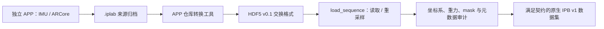

# 🛠️ 工具与交换契约 / Tools and Exchange Contracts

[中文](#中文) · [English](#english)

## 中文

| 工具 | 规范入口 | 本仓库职责 |
| :--- | :--- | :--- |
| Inertial Positioning Lab | [BUG423/app-inertial-lab](https://github.com/BUG423/app-inertial-lab) | 交换契约与数据读取测试；源码、APK、转换和端侧测试独立维护 |
| PaperFlow IO | [tools/paperflow-io/](../tools/paperflow-io/) | IO 选题、来源复核、可行性与实验设计，保留独立条款 |
| 公共数据转换 | [data/converters/](../src/inertial_benchmark/data/converters/) | 按现有 converter API 和 ipb convert 解析、审计、输出原生 v1 |
| Ops v1 | [tools/ops_v1/README.md](../tools/ops_v1/README.md) | 独立环境部署、私有 SSH 配置与服务器验收；不在公开文档保存凭据 |

ARCore 是相机与 IMU 融合的 VIO **参考源**，不能称为独立 Vicon/RTK 真值。保留姿态方向、坐标系、来源与有效掩码，显示平滑不替代归档数据。

`.iplab` 解析与 Android 构建见[独立 APP 文档](https://github.com/BUG423/app-inertial-lab)。本仓库不内嵌 APP、不发布其 APK。

`load_sequence()` 在内存中读取/重采样 v0.1，保留 archive_format、来源与原 world_frame；不会静默修改坐标系或重写源文件。v1 校验要求 gravity_aligned_z_up 等约定，因此旧文件可读取不代表能直接进入原生 v1 惰性训练。兼容读取将 valid/orientation 与 valid/position 合并为 valid_pose；位置有效、姿态无效不代表完整位姿有效。

[独立数据契约测试](../tests/test_android_data_contract.py)使用合成 HDF5 核对元数据、物理重力、任务视图及显式校验限制，不依赖 APP 源码。

## English

Android source, builds, APKs, `.iplab` conversion and device tests belong to [BUG423/app-inertial-lab](https://github.com/BUG423/app-inertial-lab). This repository owns exchange checks and [IO research tools](../tools/paperflow-io/).

ARCore is a camera-and-IMU VIO reference, not independent motion capture/RTK ground truth. Preserve provenance, quaternion direction, frames and validity masks.

`load_sequence()` reads/resamples v0.1 in memory while retaining archive metadata and the original world-frame declaration. It neither transforms nor relabels frames silently. Readability does not establish a native v1 dataset ready for lazy training. The native contract and physical checks still apply; legacy orientation/position validity is combined into valid_pose. See the [exchange test](../tests/test_android_data_contract.py) and [v1 design](DESIGN.md).
